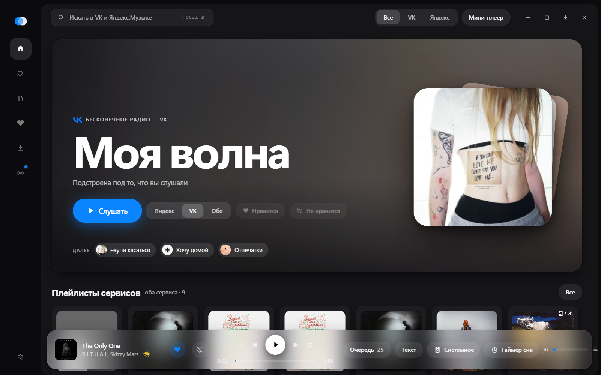
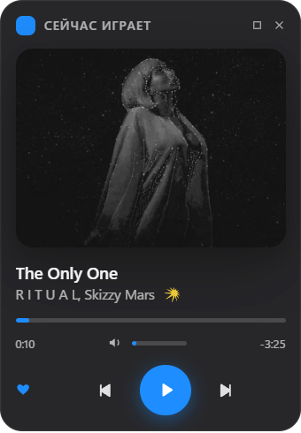
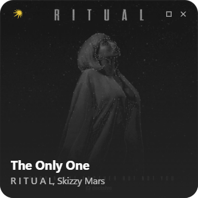
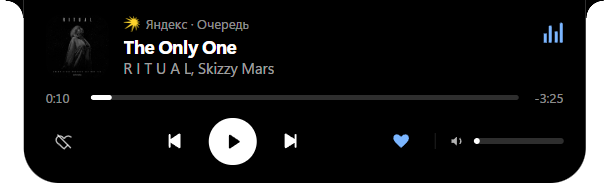
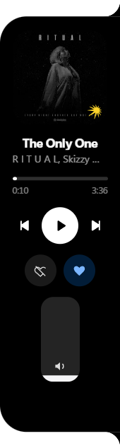
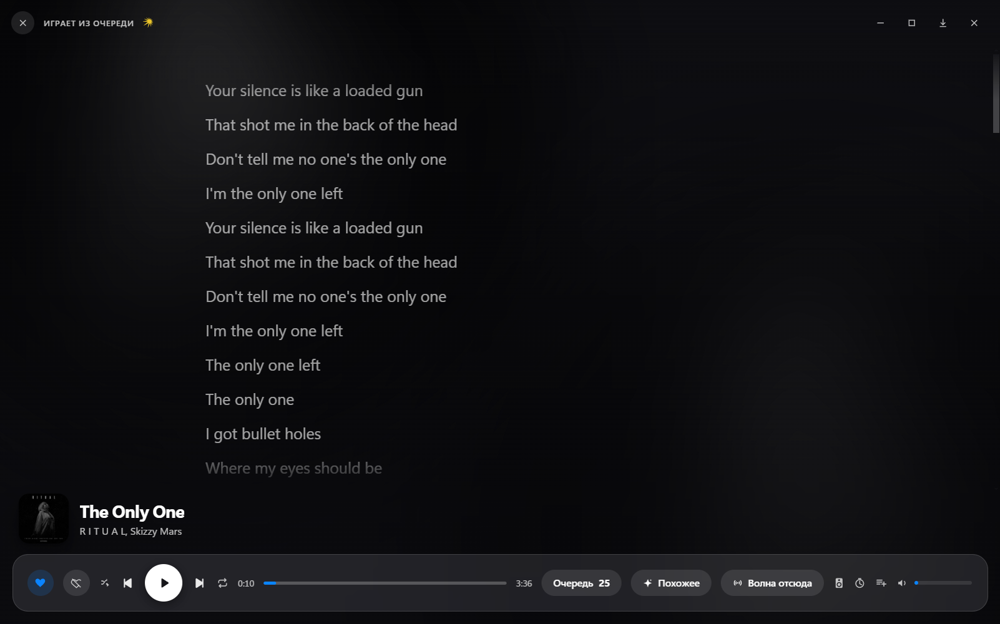
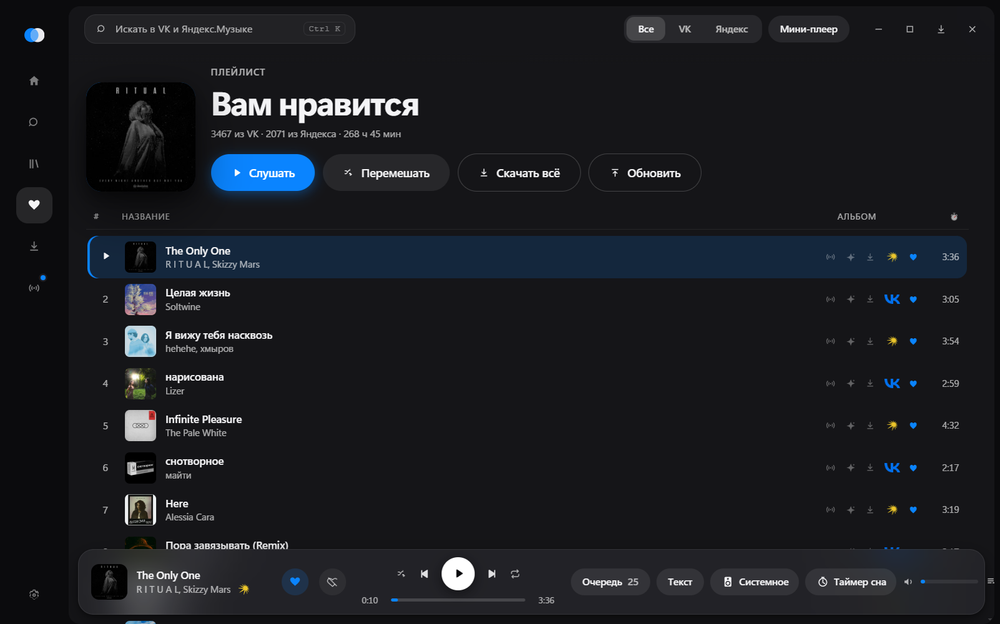
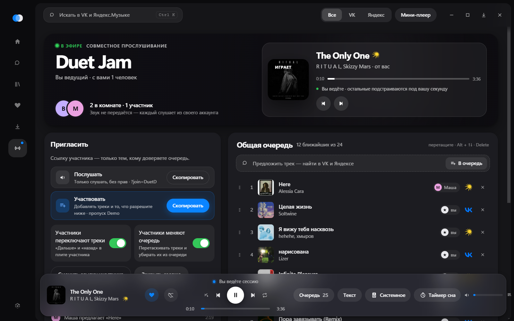
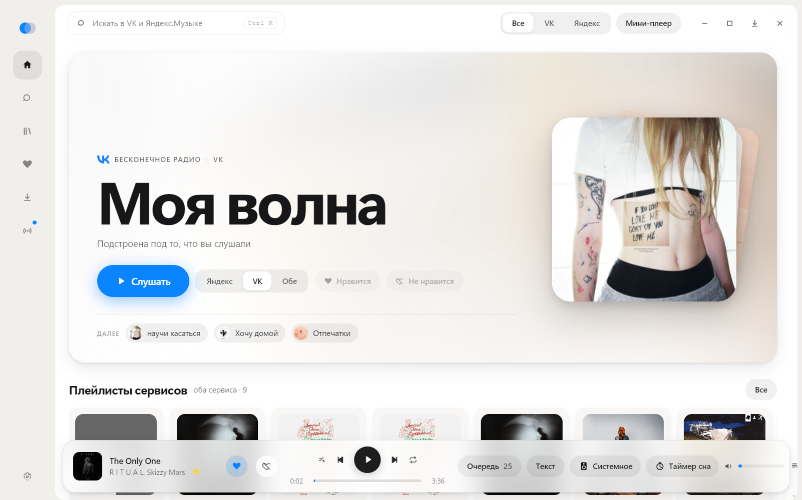
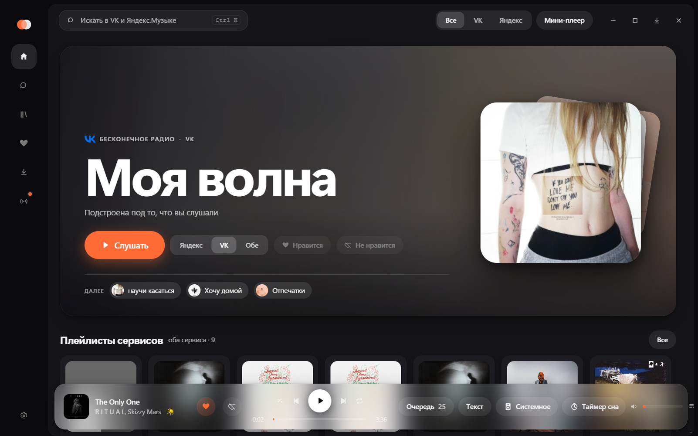

# Duet — VK Музыка и Яндекс Музыка в одном плеере для Windows

Бесплатное приложение для компьютера, в котором VK Музыка и Яндекс.Музыка
живут в одном окне. Один поиск, одна очередь, одно «Вам нравится» — и не нужно
держать открытыми две вкладки или два приложения. Есть мини-плеер поверх окон,
текст песен с подсветкой строки и совместное прослушивание с друзьями.

**[Скачать для Windows](../../releases/latest)** ·
[Сайт](https://randeronelove.github.io/Duet/) ·
Windows 10 и 11 · открытый код, MIT



Подойдёт, если вы искали:

- клиент VK Музыки для компьютера, чтобы слушать не во вкладке браузера;
- приложение Яндекс Музыки для Windows с мини-плеером поверх игр и окон;
- способ держать избранное и плейлисты из VK и Яндекса в одном списке;
- синхронный текст песен для треков VK;
- как слушать музыку вместе с другом из разных сервисов.

## Что внутри

- **Поиск сразу по обоим сервисам.** У каждого трека видно, откуда он.
- **Общее избранное и плейлисты.** Можно собрать свой плейлист, где рядом
  лежат треки из VK и из Яндекса.
- **«Моя волна» обоих сервисов** — по отдельности или вперемешку. Ещё есть
  волна по любому треку.
- **Если трек не играет в одном сервисе, Duet найдёт его во втором** и включит
  оттуда.
- **Текст песни с подсветкой строки.** Для треков VK метки времени берутся у
  Яндекса, так что подсветка работает и там.
- **Скачивание** для прослушивания без интернета, можно автоматически.
- **Мини-плеер поверх окон**, шесть видов на выбор.
- **Совместное прослушивание** по ссылке и комната, где друзья добавляют треки
  в общую очередь.
- Светлая и тёмная тема, свой цвет акцента, несколько видов главной и плеера.
- Таймер сна, горячие клавиши, статус в Discord, автообновление.

## Мини-плеер

Появляется, когда сворачиваете окно. По наведению раскрывается, его можно
перетащить куда угодно, в том числе на другой монитор.

<table>
  <tr>
    <td width="50%" valign="top">
      <br>
      <b>Полоса</b>
    </td>
    <td width="50%" valign="top">
      <br>
      <b>Пилюля</b>
    </td>
  </tr>
  <tr>
    <td valign="top">
      <br>
      <b>Карточка</b>
    </td>
    <td valign="top">
      <br>
      <b>Обложка</b>
    </td>
  </tr>
  <tr>
    <td valign="top">
      <br>
      <b>Шторка</b> — тонкая полоска у верхнего края экрана, при наведении
      раскрывается в плеер.
    </td>
    <td valign="top">
      <br>
      <b>Язычок</b> — то же самое, только сбоку.
    </td>
  </tr>
</table>

Когда вы играете или смотрите видео во весь экран, мини-плеер прячется и
возвращается, когда вы оттуда выходите. Если нужен и поверх игр — это
включается в настройках.

## Плеер и текст

Текст можно читать крупно, поверх размытой обложки. Щелчок по строке
перематывает песню к ней.



## Библиотека

Избранное из обоих сервисов — одним списком. Фильтр сверху оставляет только VK
или только Яндекс.



## Слушать вместе

Отправьте другу ссылку, и у него заиграет тот же трек с той же секунды. Звук не
передаётся: каждый слушает из своего аккаунта. Другу нужен Duet и хотя бы один
подключённый сервис — если у вас играет Яндекс, а у него только VK, Duet
поищет ту же песню в VK. Можно звать и через статус в Discord.

Если дать ссылку участника, получится **Duet Jam** — общая комната: все
добавляют треки в очередь, а ведущий решает, можно ли остальным переключать и
переставлять.



## Оформление

<table>
  <tr>
    <td width="50%"></td>
    <td width="50%"></td>
  </tr>
</table>

Тема светлая, тёмная или как в Windows. Цвет акцента можно выбрать или взять
с обложки того, что играет. Анимации настраиваются и выключаются.

## Установка

1. Скачайте `Duet-<версия>-setup.exe` из [Releases](../../releases/latest).
2. Запустите. У сборки нет цифровой подписи, поэтому Windows может спросить,
   точно ли её открывать.
3. Войдите в VK и/или Яндекс. Вход идёт через настоящие страницы сервисов
   внутри приложения: Duet не видит ваш пароль и хранит только сессию.

Дальше Duet обновляется сам — новая версия ставится, когда вы закрываете
приложение.

## Для разработчиков

```bash
npm ci
npm run dev      # запуск в режиме разработки
npm run build    # проверка типов и сборка
npm run dist     # установщик в release/
```

Нужен Node 18+, установщик собирается только на Windows. Сервер для
совместного прослушивания — [`server/relay.mjs`](server/relay.mjs), как его
поднять, написано в [`server/README.md`](server/README.md).

## Важно

Duet ходит в VK и Яндекс теми же путями, что и их официальные приложения, от
вашего имени. Это не публичное API: оно может поменяться в любой момент, а
такое использование может расходиться с правилами сервисов. Проект сделан для
себя — пользуйтесь на свой страх и риск. Скачанные треки — для личного
прослушивания.
